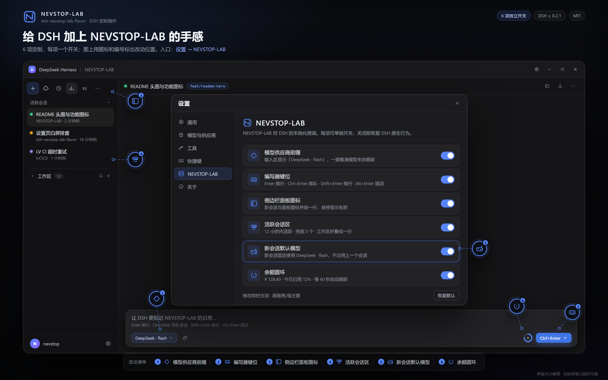

# dsh-nevstop-lab-flavor



让 DSH 更贴合 NEVSTOP-LAB 使用习惯的本地化定制插件。功能逐项开关，关掉即恢复 DSH 原生行为。

## 功能一览

| 图标 | 功能 | 默认 | 一句话 |
|---|---|---|---|
|  | 模型供应商前缀 | 开 | 在模型名旁显示它来自哪个供应商 |
|  | 编写器键位 | 开 | 自定义 Enter / Ctrl+Enter / Shift+Enter / Alt+Enter 的作用 |
|  | 侧边栏面板图标 | 开 | 左侧栏顶部只显示一排图标：「新会话」与面板列表并排，悬停显示名称 |
|  | 活跃会话区 | 开 | 「工作区」上方列出最近活跃的会话，「工作区」列表折成一行标题、默认折叠 |
|  | 新会话默认模型 | 开 | 新会话固定使用设置的模型，不沿用上一个会话的模型 |
|  | 余额圆环 | 开 | 输入框右侧显示余额或用量圆环，悬停看详情、点击可刷新 |

设置入口：**设置 → NEVSTOP-LAB**。发送按钮的外观与快捷键提示跟随「编写器键位」开关，不单独占开关。

界面文案跟随 DSH 的语言设置：提供简体中文与英文，其余语言自动回退英文。

##  模型供应商前缀

开启后，输入区模型按钮与模型菜单的当前值显示「供应商 · 模型」，例如：

- `DeepSeek · flash`
- `opencode-go · flash`

菜单里每个模型选项仍只显示模型名，供应商由分组标题表达。关闭后恢复为只显示模型名。

##  编写器键位

Enter、Ctrl（macOS 上为 Cmd）+ Enter、Shift + Enter、Alt + Enter 四行分别可选：

| 选项 | 效果 |
|---|---|
| 换行 | 在草稿里换行，不发送 |
| 排队发送 | 发送这条消息；Agent 正在运行时排进队列 |
| 插话发送 | 发送这条消息；Agent 正在运行时插进当前回合 |

默认：Enter 换行、Ctrl + Enter 排队发送、Shift + Enter 换行、Alt + Enter 插话发送。

输入框为空时，占位提示会在官方文案后追加当前键位（如 `Enter 换行 · Ctrl+Enter 排队 · Shift+Enter 换行 · Alt+Enter 插话`），改完设置立即更新。以下情况保持 DSH 原生行为：

- `/` 与 `@` 菜单打开时，Enter 仍然是选择菜单项；
- 输入法组词过程中的回车；
- Ctrl + Shift + Enter 等组合；
- 输入框为空且 Agent 正在运行时，Ctrl + Enter 仍是「插话发送全部排队消息」。

## 发送按钮

输入框右下角的发送/停止按钮高 28 px、圆角取 `--dsw-radius-md`（12 px），与同排的模型选择器、余额圆环同高，配色沿用 DSH 原样。

发送状态下，按钮内部在箭头图标右侧显示当前配置的发送键（默认 `Ctrl+Enter`，macOS 为 `Cmd+Enter`）：取「排队发送」键，没有时取「插话发送」键。停止状态下显示 `ESC ESC`——内置的停止快捷键要求连按两次 ESC（第一次只记录，第二次才真正取消）；发送中转圈时不显示。按钮宽度随文字变化，高度与右边界保持固定；窗口宽度 ≤767 px（手机布局）时只显示图标。圆形外观、发送键与 `ESC ESC` 提示都跟随「编写器键位」开关，关闭后恢复 DSH 原生按钮。

##  侧边栏面板图标

左侧栏顶部只保留一排图标：大号「新会话」按钮收成图标，排在面板图标（插件、自动化任务、上下文洞察、过程叙述等）前面，「更多」入口同样是一个图标，鼠标悬停时显示对应名称。点「新会话」图标的行为与大按钮一致。关闭后恢复原生布局：大号「新会话」按钮 + 「图标 + 文字」的竖排面板列表。

##  活跃会话区

在「工作区」列表上方新增一块「活跃会话」：

- 列出最近 n 小时内活跃的会话，按最后活动时间倒序，最后活跃的在最上面；
- 行样式与工作区里的会话行一致：标题、运行状态点、「…」菜单与右键菜单都复用内置会话行的动作；
- 第二行用小字显示所属工作区与相对时间；点击行打开该会话，悬停显示完整标题、路径与状态；
- 行符合内置会话行的 DOM 契约，安装 `dsh-plugin-busy-workspace` 时同样被它的注意力规则着色：待处理、运行中、已完成（未读）、已中断，并显示子智能体胶囊；该兼容可在设置页用「兼容 busy-workspace」开关单独关闭（默认开启）；
- 待审批、计划待审、待回答会直接显示在第二行；
- 所在工作区已归档、未开始的空白会话与子代理会话不进入列表；
- n 小时内完全没有活跃会话时，改为显示最近 5 个（数量可设置）会话，并在列表上方注明；
- 活跃会话区可折叠，默认展开。

同时把内置的「工作区」列表折成一行标题：点标题展开或收起，默认折叠；点标题里的搜索、视图、添加工作区按钮会自动展开。折叠状态不持久化，刷新后回到默认。关闭该功能后恢复原生侧栏。

默认窗口为 12 小时，可在设置页调整（1–168 小时）与兜底数量（1–50 个）。

##  新会话默认模型

开启后，新建的会话固定使用设置里选择的模型，而不是沿用上一个会话用过的模型，避免选错模型造成额外花费。

- 设置 → NEVSTOP-LAB → 「新会话默认模型」：先选供应商，再选模型；选项来自当前可用的模型目录，未登录或没有可用凭证时提示无法读取目录。
- 只作用于「尚未开始」的新会话：它出现时被设为该模型；一旦发出第一条消息，或在会话里手动换过模型，就不再改写。
- 已有会话完全不受影响；关闭开关即恢复内置行为（沿用宿主默认/上次模型）。
- 配置的模型被删除或不可用时，设置页提示重新选择；新会话会尝试设置几次后放弃，等你改配置再重试。

##  余额圆环

输入框右侧显示一个圆环：

- 悬停显示当前供应商、模型、余额或套餐用量；
- 点击展开面板：可刷新、查看各币种余额与充值/赠金明细；余额模式下点面板里的齿轮可设置「满格参考金额」；
- 跟随模型切换自动查询，每 60 秒更新；查询失败时保留上次结果并标注「上次查询值」；
- opencode Go 模型显示三档用量环（外圈滚动 / 中圈周 / 内圈月，按剩余百分比）。
关闭后圆环消失，输入框恢复原样。
## 设置页

- 每个功能一张卡片，右侧是开关；
- 开启时展开该功能的配置，关闭时收起；
- 底部「恢复默认」一次性还原所有功能与键位；
- 修改即时生效，跟随亮/暗色主题。

## 安装

```powershell
dsh plugin --profile desktop add github:NEVSTOP-LAB/dsh-nevstop-lab-flavor
```

安装后刷新 Web 页面。

## 配置

设置保存在 `%USERPROFILE%\.dsh\plugin-data\dsh-nevstop-lab-flavor\config.json`，也可以在设置页里直接改。

## 兼容

DSH `>=0.2.1-rc.0 <0.3.0-0`。

## 维护

- `assets/hero.png` 是 README 顶图的渲染产物，源文件为 `assets/hero/source.html`：改完界面或功能文案后运行 `npm run hero` 重新生成，判定标准见 `docs/hero.md`。
- `assets/icons/` 是功能图标的唯一源文件，README、头图与插件设置页共用；改动时三处同步。
- PR 模板里有对应的评估项，CI 会在界面改动而头图未更新时给出提醒。

## License

MIT
